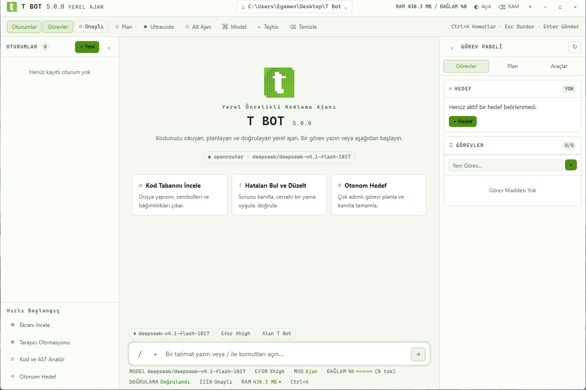

# T Bot 5.0 "Sinyal"

T Bot, terminalden veya Windows masaüstü uygulamasından kullanılan **yerel** bir yapay zekâ kodlama ajanıdır. CLI/TUI, Electron masaüstü ve Telegram aynı çekirdeği, aynı komut kataloğunu ve aynı onay akışını paylaşır. Ayrı bir bulut backend'i yoktur: oturumlar, bellek, checkpoint'ler, artifact'lar ve araç yürütme yerelde kalır; model, tarayıcı, MCP ve Telegram bağlantıları kullanıcı yapılandırmasına bağlıdır.

5.0 "Sinyal" sürümü üç hedefe odaklanır: **güvenilir araç çağırma**, **güvenlik ve doğruluk sınırlarının kodda uygulanması** ve **tek komutla `release` dalından kurulum**. Arayüzde aynı sakin grafit/Tabit yeşili dil korunur.

## Yerel ve çok sağlayıcılı mimari

```text
CLI / TUI ─────┐
Desktop ───────┼──> Surfaces ──> AgentRuntime ──> Providers
Telegram ──────┘                     │
                                     ├──> RequestBrief / TaskContract
                                     ├──> ContextEngine (repo map, artifacts)
                                     ├──> ToolRuntime (registry, effect, approval)
                                     └──> Evidence / Grounding / Undo
                                              │
                              Session + Memory + Secrets + Checkpoints
```

- **Model profili:** `small`, `standard` ve `reasoning` profilleri tur, araç çağrısı ve geçmiş bütçesini belirler. Küçük modeller tek araç/tek adım moduna alınır; `flash` benzeri araç yetenekli modeller yanlışlıkla zayıf sayılmaz.
- **Deterministik niyet:** Türkçe/İngilizce sözlük ve cümle çözümlemesi (`core/lexicon`, `core/request-brief`) yazma/okuma niyetini ve açık `no-write` sınırlarını modele sormadan çıkarır. Belirsizlikte yazma izni açık, güvenlik sınırı kapalı davranır.
- **Araç kaydı ve ortak kapılar:** Araç adları tek noktada kanonikleştirilir, yinelenen tanımlar tekilleştirilir ve yan etki sınıfı (`read`, `write`, `shell-write`, `shell-read`, `external`, `observe`) faz, kısıt ve onay kapılarında ortak kullanılır. Kanonikleştirme bir yardımcıdır; kapı, onay ve dağıtım ajan ile araç dağıtıcısı katmanındadır.
- **Yerel durum:** Oturumlar, bellek, sırlar, checkpoint'ler ve büyük araç çıktıları makinede tutulur. Hiçbir telemetri sunucusu yoktur.

## Kurulum

Önce **Node.js >=22.12.0, npm ve Git** kurulu olmalıdır.

Windows PowerShell:

```powershell
irm https://raw.githubusercontent.com/egemenkrdsek-boop/t-bot/release/scripts/install.ps1 -ErrorAction Stop | iex
```

Linux / macOS:

```sh
sh -c 'script=$(curl -fsSL https://raw.githubusercontent.com/egemenkrdsek-boop/t-bot/release/scripts/install.sh) && printf "%s\n" "$script" | sh'
```

Betikler `release` yayın dalını benzersiz bir geçici dizine klonlar, `HEAD` değerini `origin/release` ile (veya verilen tag ile) karşılaştırır, kilitli bağımlılıklarla derler ve sürüm/yardım kontrolünden sonra tarball'ı global kurar. Derleme veya paketleme başarısızsa mevcut global CLI'ye dokunulmaz. Global yazma sırasında hata veya `--version` uyuşmazlığı olursa önceki `t-bot-cli` paketi ve bin shim'leri yedekten geri yüklenir; bu, paylaşılan bağımlılıkları kapsayan tam bir anlık görüntü değildir.

`main` dalına push yapılmaz; kurulum ve güncelleme `release` dalını izler. Farklı bir dal için `TBOT_INSTALL_REF=<dal>` (PowerShell: `$env:TBOT_INSTALL_REF='<dal>'`), tam commit için `TBOT_INSTALL_REVISION` kullanılabilir. 5.0 yalnız `release` dalıyla yayımlanır; `v5.0.0` tag'i yalnızca açıkça yayımlanırsa oluşur ve varsayılan kurulumda kullanılmaz.

## İlk kullanım

```text
tbot config                 Sağlayıcı, model ve API anahtarını yapılandır
tbot                        Etkileşimli TUI oturumunu açar
tbot "isteğiniz"            Tek seferlik isteği çalıştırır
tbot providers              Kullanılabilir sağlayıcıları listeler
tbot doctor                 Ortam ve sistem sağlığını denetler
tbot -w <dizin>             Çalışma alanını seçer
tbot --bot                  Telegram köprüsünü başlatır
tbot --help                 Yardım menüsünü gösterir
tbot --version              Sürümü gösterir
```

İlk çalıştırmada `tbot config` ile bir sağlayıcı ve API anahtarı seçin; ardından `tbot` ile TUI'yi açın veya `tbot "..."` ile tek istek gönderin. Anahtar yoksa `tbot doctor` eksik yapılandırmayı bildirir.

## Windows masaüstü uygulaması

Kaynaktan Windows x64 yükleyicisi üretmek için:

```powershell
git clone --branch release https://github.com/egemenkrdsek-boop/t-bot.git
cd t-bot
npm ci
npm run dist:win
powershell -ExecutionPolicy Bypass -File scripts/deploy-local.ps1
```

Bu akış `release/T-Bot-Setup-5.0.0.exe` ve `release/build-manifest.json` üretir. Kurulum betiği yükleyicinin SHA256 değerini, çıkış kodunu, kurulan uygulamanın sürümünü ve `app.asar` SHA256 değerini doğrular. Yükleyici imzasızdır; Windows SmartScreen uyarabilir.

Geliştirme için:

```powershell
npm run desktop
```



## 5.0 ile gelenler

### Güvenlik ve doğruluk

- Hassas dosya politikası tek bir modülde birleştirildi (`security/denylist`): dosya arama sonuçları, onay metni, Vercel paketleme ve Telegram çıktısı aynı listeyi kullanır; eşleşen içerik redakte edilir.
- Screenshot'lar çalışma alanına sınırlandırılır; dışarı junction/symlink üzerinden yazma ve dış PNG/JPG silme reddedilir.
- Telegram yetkisi kullanıcı kimliği bazına indirildi. Grup onayları, `TELEGRAM_ALLOWED_USERS` içinde açıkça listelenmedikçe **kapalıdır**; onay yükü gösterilmeden önce sırlar maskelenir.
- MCP stdio bağlantıları açık onaya bağlanır; çalışma dizini workspace ile sınırlandırılır.
- Faz kapıları salt-okunur sözleşmede kabuk üzerinden yazmayı da reddeder. İptal edilen turda her araç çağrısı için eksiksiz bir araç mesajı bırakılır.
- Nihai yanıt, son yazmadan sonra yapılmış bir doğrulama kanıtı olmadan "tamamlandı" diyemez.

### GUI ergonomisi

- `computer` aracı sayısal pencere handle'ı yerine oturum kimlikleri (`w1`, `w2`), pencere başlığı veya süreç adıyla hedefleme kabul eder; handle verilmezse aktif pencere kullanılır.
- `browser_click`/`browser_type` hedefi `selector`, `ref` veya görünen metinle verilebilir; bayat `ref` tek otomatik yeniden inceleme yapar, bilinmeyen sekme aktif sekmeye düşer.
- Tarayıcı URL politikası `url_fetch` ile aynı genel ağ denetimini kullanır; her yönlendirme yeniden doğrulanır.

### Arayüz

- CLI/TUI ve masaüstü aynı komut kataloğunu (`commands.ts`) ve aynı plan/todo/diff/onay akışını kullanır.
- Masaüstünde tur yarıda kesilirse veya pencere kapanırsa kullanıcı mesajı, yarım yanıt ve araç sonuçları kaydedilir; oturum yeniden açıldığında kaybolmaz.
- Grafit yüzeyler, tek Tabit yeşili vurgu, monospace kod ve klavye öncelikli akış korunur; `prefers-reduced-motion` hareketi kapatır.
- Terminal teması `TBOT_THEME=light|dark` ile açıkça seçilir; değer verilmezse `COLORFGBG` arka plan ipucu kullanılır. `NO_COLOR`, `TBOT_ASCII=1` ve `TERM=dumb` davranışı korunur.
- Sağlayıcı 402/model hatası döndürürse `TBOT_FALLBACK_MODEL` (veya yapılandırmadaki fallback model) ile tek seferlik model geçişi yapılabilir; bu otomatik ücretli failover değildir.

### Kurulum ve dağıtım

- Kurulum varsayılanı `release` dalıdır; `main`e push yapılmaz.
- Global kurulum öncesi önceki CLI yedeklenir; hata veya sürüm uyuşmazlığında geri yüklenir.
- Paket ve masaüstü çıktısından `*.js.map` dosyaları çıkarıldı.
- CI action'ları tam commit SHA'sına sabitlendi ve yüksek önem dereceli bağımlılık denetimi eklendi.

## Komutlar

| Komut | Açıklama |
| --- | --- |
| `tbot` | Etkileşimli TUI oturumu |
| `tbot "istek"` | Tek seferlik istek |
| `tbot config` | Sağlayıcı/model/anahtar yapılandırması |
| `tbot providers` | Sağlayıcı kataloğu |
| `tbot doctor` | Ortam, sağlayıcı ve sandbox sağlığı |
| `tbot sessions` | Kayıtlı oturumlar |
| `tbot --resume <id>` | Oturuma devam |
| `tbot --bot` | Telegram köprüsü |
| `/plan`, `/plan apply` | Planlama ve onaylı uygulama |
| `/ultracode`, `/subagents` | Çok aşamalı ve paralel iş akışları |
| `/checkpoints`, `/undo` | Dosya checkpoint'i ve geri alma |
| `/tokens`, `/memory` | Token/bağlam ve bellek raporu |
| `/gui`, `/mcp`, `/bot` | GUI, MCP ve Telegram yönetimi |
| `/yolo`, `/effort` | Onay politikası ve düşünme eforu |

## Sağlayıcılar

Gemini, OpenAI (Chat Completions ve Responses), Anthropic, OpenRouter, Groq, DeepSeek, xAI, Mistral, Ollama, LM Studio ve OpenAI uyumlu özel uç noktalar desteklenir. Model listesi sağlayıcıdan canlı alınır; çevrimdışıysa yerel fallback kataloğu kullanılır. Otomatik ücretli failover yoktur; sağlayıcı değişimi kullanıcı kararıdır.

## Telegram

BotFather'dan aldığınız tokenı, izin verilen sohbetleri ve tercihen kullanıcı kimliklerini yapılandırın:

```powershell
$env:TELEGRAM_BOT_TOKEN = '<bot-token>'
$env:TELEGRAM_ALLOWED_CHATS = '<chat-id>'
$env:TELEGRAM_ALLOWED_USERS = '<user-id>'
tbot --bot
```

Allowlist boşsa yerel terminal tek kullanımlık `/pair <32-karakter hex kod>` gösterir. Kod 10 dakika ve toplam 10 deneme ile sınırlıdır. **Grup sohbetlerinde araç onayı yalnızca `TELEGRAM_ALLOWED_USERS` içinde listelenen kullanıcılar tarafından verilebilir**; kullanıcı listesi boşsa grup onayları kapalı kalır. Özel sohbette eski tek kullanıcı eşleştirmesi çalışmaya devam eder.

## Güvenlik modeli ve sınırları

- Kabuk, dosya yazma, GUI mutasyonları, URL indirme, checkpoint geri yükleme ve doğrulama komutları varsayılan olarak onay ister; saf gözlemler ayrı onay istemez.
- Açık kullanıcı sınırları (`no-write`, `no-command`, yalnız-yol allowlist'i) model talimatından bağımsız olarak araç katmanında uygulanır. Bu, eksiksiz bir OS sandbox değildir.
- `TBOT_SANDBOX=required` seçildiğinde Linux'ta bubblewrap, macOS'ta sandbox-exec aranır; adaptör yoksa kabuk fail-closed durur. **Windows'ta OS sandbox adaptörü yoktur**; onay ve yetenek politikası asıl sınırdır.
- Gizli anahtarlar Windows'ta DPAPI + kullanıcıya özel ACL ile saklanır; alt süreç ortamından sır adları çıkarılır. Redaksiyon sezgiseldir; bilinmeyen biçimleri yakalama garantisi yoktur.
- Web, MCP ve araç içeriği güvenilmeyen kanıt sayılır. Prompt injection için kesin garanti verilmez; onay ve araç yetkisi gerçek sınırdır.
- Kabuk komutları kullanıcı izinleriyle çalışır ve gerçek dosya sistemi/ağ etkisi üretebilir.

## Doğrulama ve kanıt

- Testler birim/bileşen ve kaydedilmiş fixture'lardır; E2E otomasyonu yoktur. 5.0'da ayrıca GLM (effort low) ve scratch workspace ile hedefli canlı koşular, gerçek yerel computer ve browser oturumları yapıldı; bunlar birim testi veya geniş model matrisi yerine geçmez.
- Kaynak, test, paket, masaüstü ve kurulum kanıtları [doğrulama kaydının](docs/verification.md) 5.0 bölümündedir. Rollback'in canlı global hata senaryosuyla doğrulanmadığı ve diğer sınırlar aynı kayıtta açıkça yazılıdır.
- "Dünya #1", rakiplere göre yüzde tasarruf veya ölçülmemiş performans iddiası yapılmaz. Token değerleri sağlayıcı faturası değil, yerel tahmindir.
- TypeScript/JavaScript ve JSON kontrolleri tüm diller için doğrulama garantisi değildir. Windows dışı masaüstü kontrolü vaat edilmez.

## Sorun giderme

- `tbot` bulunamıyorsa `npm prefix -g` çıktısını PATH'e ekleyip yeni terminal açın.
- Kurulum `release` dalını bulamazsa dalın uzakta oluşturulduğunu doğrulayın; geçici olarak `TBOT_INSTALL_REF=main` veya sabit bir commit kullanılabilir. `main`e push yapılmaz.
- Güncelleme sonrası sürüm yanlışsa betik önceki CLI'yi geri yüklemeyi dener; geri yükleme başarısızsa önceki sürümü `npm install -g t-bot-cli@<sürüm>` ile yeniden kurun.
- Derleme hatasında ilk TypeScript/asset hatasını düzeltin; betik hatayı yutmaz.
- API `401` hatasında `tbot config` ile anahtarı yenileyin ve sağlayıcının model erişimini kontrol edin.
- Yapılandırma Windows'ta `%APPDATA%\TBot`, diğer sistemlerde `~/.config/TBot` altındadır.
- Masaüstü geliştirmede Electron ikilisi eksikse `ELECTRON_SKIP_BINARY_DOWNLOAD` değişkenini kaldırıp `node node_modules/electron/install.js` çalıştırın.

## Lisans ve üçüncü taraf

T Bot [MIT lisansı](LICENSE) ile dağıtılır. OpenCode'un Unicode düzenleme eşleştirme/satır sonu koruma yordamları ve Hermes Agent'ın token bütçesine göre bağlam penceresi planlaması sabit commit'lerden uyarlanmıştır. Kaynaklar, commit'ler ve lisans metinleri [THIRD_PARTY_NOTICES.md](THIRD_PARTY_NOTICES.md) ile [THIRD_PARTY_DEPENDENCIES.md](THIRD_PARTY_DEPENDENCIES.md) dosyalarındadır.

Ayrıntılar: [Mimari](docs/architecture.md), [Kurulum](docs/install.md), [Doğrulama](docs/verification.md), [Rakiplik boşluk matrisi](docs/competitor-gaps.md), [5.0 karar notu](docs/decisions/5.0-signal.md).
